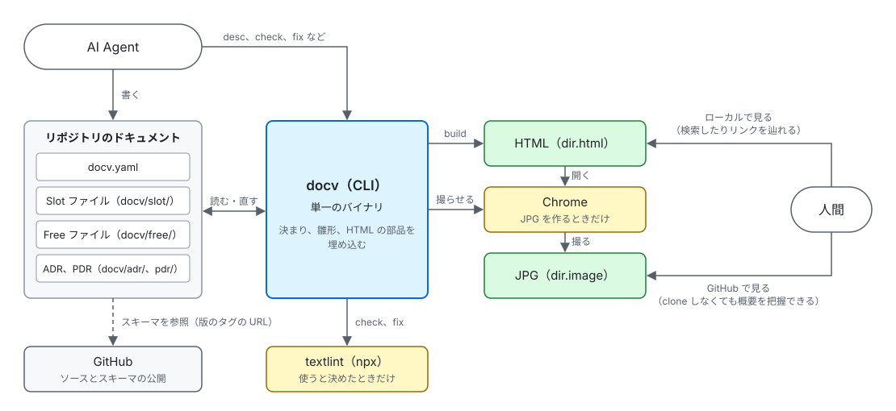

# システム概要

docv は、利用者のリポジトリの中で動く単一の CLI で、サーバーを持たない。リポジトリのドキュメントを読み、検査と整形をし、人間が見る HTML を作る。外の道具は、使うと決めたときだけ呼ぶ。

| 部品                     | 役割                                                                                                                                                                                                                                                                     |
| ------------------------ | ------------------------------------------------------------------------------------------------------------------------------------------------------------------------------------------------------------------------------------------------------------------------ |
| docv（CLI）              | ドキュメントを検査し、整形し、HTML を作る。決まり、雛形、HTML の部品を埋め込み、1 つのバイナリにする                                                                                                                                                                     |
| リポジトリのドキュメント | `docv.yaml`、Slot ファイル、Free ファイル、ADR、PDR。AI Agent と人間が書き、docv が読む。fix は書き直す                                                                                                                                                                  |
| textlint                 | 日本語の文章を検査する。`docv.yaml` で使うと決めたときだけ、check と fix が npx で呼ぶ                                                                                                                                                                                   |
| Chrome                   | HTML のページを JPG にする。`docv.yaml` の `generate.image` が true のときだけ、build が動かす                                                                                                                                                                           |
| HTML、JPG                | build の出力。人間が全体像を掴むために見る。HTML はローカルで開き、検索したりリンクを辿れる。JPG は git で管理すれば GitHub で見られ、clone しなくても概要を把握できる。GitHub で Slot ファイルと JPG を辿る入り口のインデックス（`document_root` の `README.md`）も書く |
| GitHub                   | ソースを置き、スキーマを版のタグごとに公開する。利用者は、ソースから cargo で docv を入れる。YAML の Slot と `docv.yaml` の 1 行目が、スキーマを指す                                                                                                                     |

部品ごとの振る舞いと部品の間の流れは [システム仕様](system.md)、全体で採る方式と決まりは [アーキテクチャ](../guide/architecture.md)。使っている言語とライブラリは、[技術スタック](stack.yaml)。
