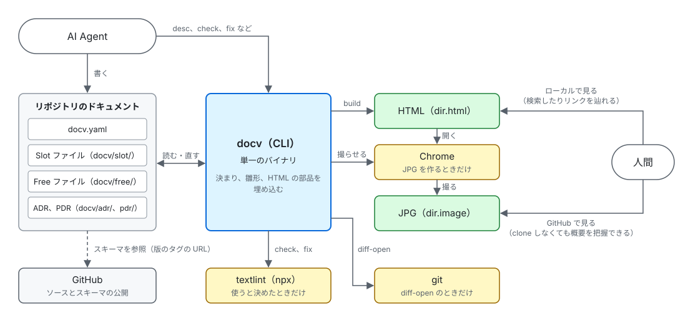

# システム概要

docv は、利用者のリポジトリの中で動く単一の CLI で、サーバーを持たない。リポジトリのドキュメントを読み、検査と整形をし、人間が見る HTML を作る。外の道具は、使うと決めたときだけ呼ぶ。

| 部品                     | 役割                                                                                                                                                                                                                 |
| ------------------------ | -------------------------------------------------------------------------------------------------------------------------------------------------------------------------------------------------------------------- |
| docv（CLI）              | ドキュメントを検査し、整形し、HTML を作る。決まり、雛形、HTML の部品を埋め込み、1 つのバイナリにする                                                                                                                 |
| リポジトリのドキュメント | `docv.yaml`、Slot ファイル、Free ファイル、ADR、PDR。AI Agent と人間が書き、docv が読む。fix は書き直す                                                                                                              |
| textlint                 | 日本語の文章を検査する。`docv.yaml` で使うと決めたときだけ、check と fix が npx で呼ぶ                                                                                                                               |
| git                      | 比べるリビジョンと作業ツリーの差分を取る。diff-open のときだけ呼ぶ。diff-open は、変わったファイルに印を付けた HTML を、OS のキャッシュのディレクトリに書いて開く                                                    |
| HTML、インデックス       | build の出力。人間が全体像を掴むために見る。HTML はローカルで開き、検索したりリンクを辿れる。インデックス（`document_root` の `README.md`）は、GitHub で Slot ファイルを辿る入り口で、clone しなくても Slot を読める |
| GitHub                   | ソースを置き、スキーマを版のタグごとに公開する。利用者は、ソースから cargo で docv を入れる。`docv.yaml` の 1 行目が、スキーマを指す                                                                                 |
